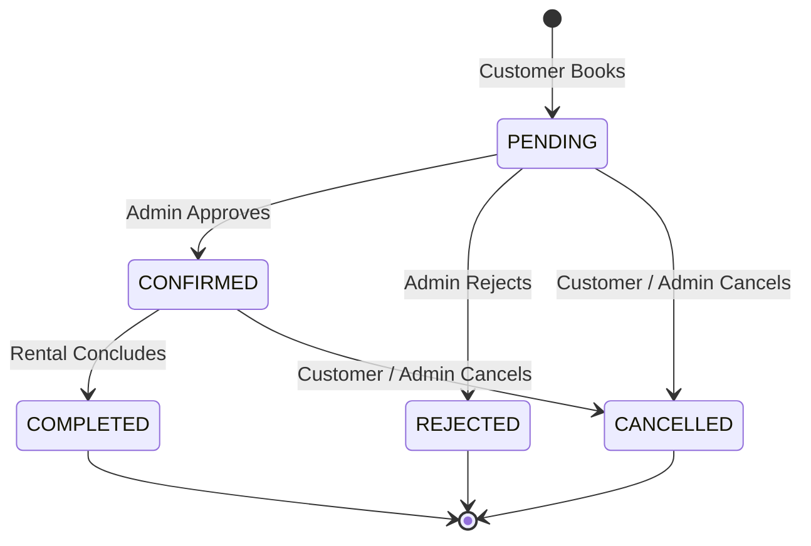

# DriveEase — Vehicle Rental Management System (MERN Stack)

> **B.Tech Full-Stack Development-2 (FSD-2) Laboratory Capstone Project**  
> An enterprise-grade, responsive, full-stack vehicle rental platform designed for commercial vehicle operations, secure customer bookings, and fleet administration.

---

## 1. Project Overview

**DriveEase** is an end-to-end self-drive vehicle rental management application built using the **MERN stack** (MongoDB, Express.js, React, Node.js) with Vite and Tailwind CSS. The platform bridges the gap between vehicle rental providers and end customers by replacing paper logs and fragile spreadsheets with automated availability calculation, server-enforced rental pricing, role-based access control, and a sleek, modern commercial interface.

### Key Highlights
- **Zero-Friction Customer Experience**: Instant vehicle search, live date-range availability checks, dynamic price breakdowns in Indian Rupees (₹), and personal booking tracking.
- **Administrative Fleet Control**: Real-time business metrics (active bookings, completed rental revenue, fleet utilization), inventory CRUD, and booking lifecycle state-machine enforcement (`PENDING` → `CONFIRMED` / `REJECTED` → `COMPLETED` / `CANCELLED`).
- **Mathematical Date Overlap Verification**: Prevents double-booking using the standard interval-overlap algorithm enforced atomically on the backend.
- **Robust Security**: bcrypt password hashing, JWT stateless authorization, rate limiting on auth endpoints, Helmet security headers, CORS allowlisting, and input sanitization.

---

## 2. Technology Stack

| Layer | Technologies Used |
| :--- | :--- |
| **Frontend** | React 18, Vite 6, Tailwind CSS, React Router v6, Axios, Lucide React, React Hot Toast |
| **Backend** | Node.js (v24), Express.js (v5), Mongoose (v9) |
| **Database** | MongoDB Atlas (Cloud) / Local MongoDB with Replica Set support |
| **Authentication** | JSON Web Tokens (JWT), bcryptjs (Salt rounds: 10) |
| **Security & Utilities** | Helmet, Express Rate Limit, CORS, dotenv |
| **Testing** | Node.js Test Runner (`node:test`, `node:assert`), Supertest |
| **Deployment Targets**| **Vercel** (Frontend SPA with route rewrites) & **Render** (Backend API web service) |

---

## 3. User Roles & Capabilities

### 👤 Customer
- **Registration & Authentication**: Sign up with name, email, phone, and password; log in with JWT generation; update profile details.
- **Vehicle Catalog Exploration**: Browse active fleet; filter by Category (SUV, Sedan, Hatchback, Motorcycle, Luxury), Fuel Type (Petrol, Diesel, Hybrid, Electric), Transmission (Manual, Automatic), and Daily Price range slider.
- **Detailed Specifications**: Inspect 40-point specs (seats, transmission, fuel, registration, location hub, image gallery).
- **Date Selection & Real-Time Availability Check**: Select pickup and return dates with automatic past-date blocking and live overlap verification against `PENDING` and `CONFIRMED` reservations.
- **Server Price Calculation**: View an itemized pricing breakdown (Days × Daily Rate = Subtotal, Insurance, Total in ₹).
- **Booking Management**: Submit booking requests (`PENDING`), view upcoming, completed, and cancelled trips, and cancel eligible upcoming bookings.

### 🛡️ Administrator
- **Secured Admin Console**: Restricted by role-based middleware (`role === 'admin'`).
- **KPI Metrics Dashboard**: Live counters for total vehicles, active vehicles, active bookings, registered customers, and total completed rental revenue.
- **Vehicle Inventory CRUD**: Add new vehicles with image URLs, edit existing fleet parameters, and safely delete/deactivate vehicles with active bookings.
- **Booking Lifecycle Enforcement**: Review customer requests; approve (`CONFIRMED`), reject (`REJECTED`), or mark returned vehicles as finished (`COMPLETED`).
- **Customer Directory**: View customer profiles, contact numbers, and total booking volumes.

---

## 4. Booking & Availability Engine

### Interval-Overlap Rule
Double bookings are prevented using the standard mathematical interval overlap rule:
$$\text{ExistingPickup} < \text{RequestedReturn} \quad \text{AND} \quad \text{ExistingReturn} > \text{RequestedPickup}$$

```
Existing Booking:   [--------- Pickup ---------- Return ---------]
                          |                         |
Request A (Overlap): [--- Pickup --- Return ---]    |
Request B (Overlap):      |         [--- Pickup --- Return ---]
Request C (Clean):                                  [--- Pickup --- Return ---]
```

### Boundary & Date Normalization
- **Pickup Boundary**: Normalized to `00:00:00.000 UTC` on the calendar pickup date.
- **Return Boundary**: Normalized to `23:59:59.999 UTC` on the calendar return date.
- **Rental Duration Rule**: Calculated as inclusive calendar days ($N \ge 1$). A rental from 10th Jan to 12th Jan covers 3 full rental days.
- **Blocking Statuses**: Bookings with status `PENDING` (reserved awaiting approval) and `CONFIRMED` block calendar dates. Bookings marked `CANCELLED` or `REJECTED` immediately release inventory.

### Concurrency & Transaction Strategy
1. **Replica Set / MongoDB Atlas**: In production, `bookingService.js` starts a multi-document Mongoose transaction session (`session.startTransaction()`) to verify availability and insert the booking atomically under snapshot isolation.
2. **Standalone Instance Fallback**: If running on local standalone MongoDB without replica sets, the service falls back gracefully to atomic re-checks, logging the configuration mode.

### Lifecycle State Machine


---

## 5. Directory Structure

```
driveease/
├── .gitignore                      # Safe Git exclusions (node_modules, .env, build artifacts)
├── package.json                    # Workspace root scripts
├── render.yaml                     # Render.com Infrastructure-as-Code deployment blueprint
├── README.md                       # Complete documentation & viva manual
│
├── client/                         # Frontend React + Vite Application
│   ├── .env.example                # Example client environment variables
│   ├── index.html                  # HTML5 Entry Point with Inter font & metadata
│   ├── package.json                # Frontend dependencies
│   ├── postcss.config.js           # PostCSS configuration
│   ├── tailwind.config.js          # Tailwind styling configuration
│   ├── vercel.json                 # Vercel SPA rewrite configuration for nested routing
│   ├── vite.config.js              # Vite configuration
│   └── src/
│       ├── App.jsx                 # Routing table & context providers
│       ├── main.jsx                # React DOM render root
│       ├── index.css               # Tailwind directives & custom scrollbars
│       ├── components/common/      # Reusable UI components
│       │   ├── Navbar.jsx          # Responsive navigation bar with auth badge
│       │   ├── Footer.jsx          # Commercial footer with links & contact info
│       │   ├── VehicleCard.jsx     # Card component with fallback image handling
│       │   ├── StatusBadge.jsx     # Color-coded status pills
│       │   ├── LoadingSpinner.jsx  # Animated SVG spinner
│       │   ├── ProtectedRoute.jsx  # Customer authentication guard
│       │   └── AdminRoute.jsx      # Administrator role guard
│       ├── context/
│       │   └── AuthContext.jsx     # Global auth state & token management
│       ├── pages/
│       │   ├── HomePage.jsx        # Landing page with hero, search, & testimonials
│       │   ├── VehiclesPage.jsx    # Catalog page with filter drawer & pagination
│       │   ├── VehicleDetailPage.jsx # Specs gallery & live availability booking
│       │   ├── LoginPage.jsx       # Login form with 1-click Demo credentials
│       │   ├── RegisterPage.jsx    # Customer registration with validation
│       │   ├── CustomerDashboardPage.jsx # My Bookings tabs & profile edit
│       │   ├── AdminDashboardPage.jsx # Fleet CRUD & Booking management console
│       │   └── NotFoundPage.jsx    # Friendly 404 page
│       └── services/
│           └── api.js              # Axios client with JWT interceptor & service modules
│
└── server/                         # Backend Express + Node.js API
    ├── .env.example                # Server environment template
    ├── package.json                # Backend dependencies & test scripts
    ├── scripts/
    │   └── seed.js                 # Idempotent DB seeder (Admin, Customer, 9 Vehicles)
    ├── src/
    │   ├── app.js                  # Express middleware, CORS, Helmet, Rate limiter
    │   ├── server.js               # DB connection & HTTP listener with graceful shutdown
    │   ├── config/
    │   │   └── db.js               # Mongoose connection & health checker
    │   ├── controllers/
    │   │   ├── authController.js   # Register, Login, Me, Update Profile
    │   │   ├── vehicleController.js# Vehicle CRUD & Availability endpoint
    │   │   ├── bookingController.js# Create, View My, Cancel Booking
    │   │   └── adminController.js  # Dashboard stats, Bookings status, Users
    │   ├── middleware/
    │   │   ├── auth.js             # JWT verification & role authorization
    │   │   ├── errorHandler.js     # Centralized 404 and Error response handler
    │   │   └── validate.js         # ObjectId & required fields validator
    │   ├── models/
    │   │   ├── User.js             # User Mongoose schema with bcrypt methods
    │   │   ├── Vehicle.js          # Vehicle schema with unique registration & indexes
    │   │   └── Booking.js          # Booking schema with status enum & compound indexes
    │   └── services/
    │       └── bookingService.js   # Availability overlap & price calculation logic
    └── tests/
        ├── unit.test.js            # 8 Unit test suites (pricing, dates, overlap, lifecycle)
        └── api.test.js             # Integration tests (health, auth guard, validation, 404)
```

---

## 6. Installation & Local Setup

### Prerequisites
- **Node.js**: v18.0.0 or later (v20+ or v24 recommended)
- **npm**: v9.0.0 or later
- **MongoDB**: MongoDB Atlas connection URI or local MongoDB instance running on port 27017
- **Git**: Installed for version control

---

### Step 1: Clone the Repository
```bash
git clone https://github.com/your-username/driveease.git
cd driveease
```

---

### Step 2: Configure Environment Variables

#### Backend Configuration (`server/.env`)
Create `server/.env` based on `server/.env.example`:
```ini
PORT=5000
NODE_ENV=development
MONGODB_URI=mongodb+srv://<username>:<password>@cluster0.abcde.mongodb.net/driveease?retryWrites=true&w=majority
JWT_SECRET=driveease_jwt_super_secret_development_key_change_in_production_2026
JWT_EXPIRES_IN=7d
CLIENT_URL=http://localhost:5173

# Initial Administrator Credentials (used by seed.js)
ADMIN_NAME=DriveEase Administrator
ADMIN_EMAIL=admin@driveease.com
ADMIN_PASSWORD=Admin@SecureDrive2026!
ADMIN_PHONE=+91 9876543210
```

#### Frontend Configuration (`client/.env`)
Create `client/.env` based on `client/.env.example`:
```ini
VITE_API_URL=http://localhost:5000/api
```

---

### Step 3: Install Dependencies
Install dependencies in both `server` and `client`:

```bash
# Install server dependencies
cd server
npm install

# Install client dependencies
cd ../client
npm install
cd ..
```

---

### Step 4: Seed Initial Data
Run the database seed script to populate the database with the initial administrator, sample customer, and 9 realistic vehicles (Maruti Swift, Hyundai i20, Tata Nexon, Hyundai Creta, Mahindra Thar, Honda City, Royal Enfield Classic 350, KTM Duke 200, BMW 3 Series):

```bash
cd server
npm run seed
cd ..
```

> **Note on Idempotence**: The seed script checks registration numbers and email addresses before inserting. Running `npm run seed` multiple times is safe and will not generate duplicate records.

---

### Step 5: Start Development Servers

You can start the backend and frontend separately or simultaneously:

#### Terminal 1 (Backend Server):
```bash
cd server
npm run dev
# Server starts at http://localhost:5000
```

#### Terminal 2 (Frontend Client):
```bash
cd client
npm run dev
# Frontend starts at http://localhost:5173
```

Open your browser and navigate to `http://localhost:5173`.

---

## 7. Demo Accounts & Credentials

For laboratory evaluations and demonstrations, use the following pre-configured credentials (or click the **"Quick Demo Autofill"** buttons on the Login page):

| Role | Email Address | Password | Permissions |
| :--- | :--- | :--- | :--- |
| **Administrator** | `admin@driveease.com` | `Admin@SecureDrive2026!` | Full fleet CRUD, booking approvals, status transitions, metrics dashboard |
| **Customer** | `customer@driveease.com` | `Customer@12345!` | Browse fleet, date checks, create bookings, cancel own bookings, edit profile |

---

## 8. REST API Reference

All API routes are prefixed with `/api`.

### Authentication Endpoints (`/api/auth`)
| Method | Endpoint | Auth | Description | Request Body |
| :--- | :--- | :--- | :--- | :--- |
| `POST` | `/api/auth/register` | Public | Register customer account | `{ name, email, phone, password }` |
| `POST` | `/api/auth/login` | Public | Authenticate user & get JWT | `{ email, password }` |
| `GET` | `/api/auth/me` | Customer / Admin | Retrieve current profile | `Header: Authorization Bearer <token>` |
| `PUT` | `/api/auth/profile` | Customer / Admin | Update personal name & phone | `{ name, phone }` |

### Vehicles Endpoints (`/api/vehicles`)
| Method | Endpoint | Auth | Description | Query / Body Parameters |
| :--- | :--- | :--- | :--- | :--- |
| `GET` | `/api/vehicles` | Public | List active vehicles with filters | `?category=...&fuelType=...&search=...&sort=...&page=1` |
| `GET` | `/api/vehicles/:id` | Public | Get single vehicle specifications | `Params: id` |
| `GET` | `/api/vehicles/:id/availability` | Public | Check availability & price | `?pickupDate=YYYY-MM-DD&returnDate=YYYY-MM-DD` |
| `POST` | `/api/vehicles` | Admin | Add new vehicle to fleet | `{ make, model, year, category, pricePerDay, ... }` |
| `PUT` | `/api/vehicles/:id` | Admin | Update vehicle details | `{ pricePerDay, location, isActive, ... }` |
| `DELETE` | `/api/vehicles/:id` | Admin | Deactivate / Delete vehicle | `Params: id` |

### Bookings Endpoints (`/api/bookings`)
| Method | Endpoint | Auth | Description | Request Body |
| :--- | :--- | :--- | :--- | :--- |
| `POST` | `/api/bookings` | Customer | Create booking request (`PENDING`) | `{ vehicleId, pickupDate, returnDate }` |
| `GET` | `/api/bookings/my` | Customer | View customer's booking history | None |
| `GET` | `/api/bookings/:id` | Owner / Admin | View single booking details | None |
| `PATCH` | `/api/bookings/:id/cancel` | Owner / Admin | Cancel eligible booking | `{ reason? }` |

### Admin Endpoints (`/api/admin`)
| Method | Endpoint | Auth | Description | Parameters |
| :--- | :--- | :--- | :--- | :--- |
| `GET` | `/api/admin/dashboard` | Admin | Metrics (vehicles, bookings, revenue) | None |
| `GET` | `/api/admin/bookings` | Admin | View all customer bookings | `?status=PENDING&page=1` |
| `PATCH`| `/api/admin/bookings/:id/status`| Admin | Transition booking status | `{ status: "CONFIRMED"|"REJECTED"|"COMPLETED" }` |
| `GET` | `/api/admin/users` | Admin | List all registered user accounts | None |

### System Endpoints
| Method | Endpoint | Auth | Description | Response |
| :--- | :--- | :--- | :--- | :--- |
| `GET` | `/api/health` | Public | System status, uptime, & DB check | `{ status: "ok", uptime: ..., database: "connected" }` |

---

## 9. Testing & Verification

### Automated Test Suite
DriveEase includes a comprehensive test suite covering both unit logic and API integration:

```bash
cd server
npm test
```

#### Test Execution Summary:
```
▶ --- API Integration Tests: DriveEase Security & Endpoints ---
  ✔ 1. Health Check: GET /api/health responds with 200 and operational status
  ✔ 2. 404 Handler: unknown routes return standard 404 JSON response
  ✔ 3. Auth Guard: access to private endpoint /api/bookings without token returns 401
  ✔ 4. Registration Validation: returns 400 when required fields are missing
  ✔ 5. Registration Validation: returns 400 when password is too short (< 6 chars)
  ✔ 6. ObjectId Validation: returns 400 for malformed vehicle IDs
✔ --- API Integration Tests: DriveEase Security & Endpoints --- (67ms)

▶ --- Unit Tests: DriveEase Rental Engine ---
  ✔ 1. Password Hashing: verifies bcrypt hash and comparison
  ✔ 2. JWT Generation & Payload: encodes user id and role
  ✔ 3. Date Normalization: rejects dates in the past
  ✔ 4. Date Normalization: rejects return date before or equal to pickup date
  ✔ 5. Date Normalization & Duration: accurately calculates rental days (inclusive)
  ✔ 6. Price Calculation: strictly calculates total based on daily rate and days
  ✔ 7. Interval Overlap Formula: standard interval-overlap rule verification
  ✔ 8. Booking Status Transitions: strictly enforces valid lifecycle states
✔ --- Unit Tests: DriveEase Rental Engine --- (280ms)

Total: 16 passing | 0 failing | Duration: ~800ms
```

---

### Manual Testing Checklist for Lab Demonstration / Viva

| # | Workflow to Demonstrate | Steps to Perform | Expected Result |
| :---: | :--- | :--- | :--- |
| **1** | **Public Fleet Browsing** | Open `http://localhost:5173/vehicles`. Filter by "SUV" and move the price slider. | Only matching SUVs within price range appear with correct specs. |
| **2** | **Availability Check** | Click "Details" on Hyundai Creta. Select valid future dates. | Green banner displays: *"Available for 3 rental day(s)"* with accurate price breakdown. |
| **3** | **Guest Booking Guard** | Attempt to click "Proceed to Book" while logged out. | Prompt redirects to `/login` with `redirect` parameter preserved. |
| **4** | **Customer Registration** | Navigate to `/register`. Register a new user with invalid phone/short password. | Clear validation message appears; on valid submission, user is logged in. |
| **5** | **Customer Booking** | Log in as Customer. Book the Mahindra Thar for next weekend. | Booking is placed in `PENDING` state and appears on the Customer Dashboard. |
| **6** | **Overlapping Booking Rejection** | Open another tab. Attempt to book the same Mahindra Thar for overlapping dates. | Availability check flags: *"Reserved for these dates. Please choose alternate dates."* |
| **7** | **Admin Authentication** | Log in as `admin@driveease.com`. | Admin dashboard loads with fleet counters and booking management table. |
| **8** | **Admin Booking Approval** | In Admin Dashboard, locate the pending booking. Click **"Confirm"**. | Status changes to `CONFIRMED`; revenue/active bookings counters update. |
| **9** | **Booking Cancellation** | In Customer Dashboard, click "Cancel Booking" on an eligible booking. | Confirmation modal opens; on confirm, status becomes `CANCELLED`. |
| **10**| **Access Control (403)** | Logged in as customer, try to navigate directly to `/admin`. | System blocks access and redirects to customer home. |

---

## 10. Production Deployment Guide

### A. Database Deployment (MongoDB Atlas)
1. Log in to [MongoDB Atlas](https://www.mongodb.com/cloud/atlas).
2. Create a free **M0 Shared Cluster**.
3. Under **Database Access**, create a user (e.g. `driveease_user`) with read/write privileges.
4. Under **Network Access**, add `0.0.0.0/0` (Allow access from anywhere) to allow Render instances to connect.
5. Click **Connect** → **Drivers** (Node.js) and copy your connection string:
   ```
   mongodb+srv://driveease_user:<password>@cluster0.abcde.mongodb.net/driveease?retryWrites=true&w=majority
   ```

---

### B. Backend Deployment (Render)
1. Log in to [Render](https://render.com).
2. Click **New +** → **Web Service**.
3. Connect your GitHub repository.
4. Set the following build and run parameters:
   - **Root Directory**: `server`
   - **Environment**: `Node`
   - **Build Command**: `npm install`
   - **Start Command**: `npm start`
5. Under **Environment Variables**, add:
   - `NODE_ENV`: `production`
   - `PORT`: `10000`
   - `MONGODB_URI`: `<Your MongoDB Atlas connection URI>`
   - `JWT_SECRET`: `<A strong random 64-char string>`
   - `CLIENT_URL`: `https://your-driveease-app.vercel.app`
   - `ADMIN_EMAIL`: `admin@driveease.com`
   - `ADMIN_PASSWORD`: `<Your secure production admin password>`
6. Deploy the web service. Once deployed, note your Render URL (e.g., `https://driveease-api.onrender.com`).
7. Verify health: `https://driveease-api.onrender.com/api/health`.

---

### C. Frontend Deployment (Vercel)
1. Log in to [Vercel](https://vercel.com).
2. Click **Add New...** → **Project** and import your Git repository.
3. Configure the project settings:
   - **Framework Preset**: `Vite`
   - **Root Directory**: `client`
4. Under **Environment Variables**, add:
   - `VITE_API_URL`: `https://driveease-api.onrender.com/api`
5. Click **Deploy**.
6. The included `client/vercel.json` ensures that deep-linking and browser refreshes on routes like `/vehicles/:id` or `/dashboard` redirect to `/index.html` seamlessly without 404 errors.

---

## 11. Security & Reliability Implementations

- **Password Hashing**: Industry-standard `bcryptjs` with salt rounds = 10. Passwords are never stored or logged in plain text.
- **Stateless JWT Tokens**: Expire in 7 days; validated on every protected route. `passwordHash` is excluded from user queries and JSON transforms.
- **Mass-Assignment Defense**: Role escalation is blocked server-side. The registration endpoint strictly sets `role: 'customer'`, ignoring any `role` passed in the body.
- **Rate Limiting**: Protects sensitive `/api/auth/` routes against brute-force attacks (`express-rate-limit`: 100 requests per 15 minutes window).
- **Helmet Headers**: Injects secure HTTP response headers to defend against clickjacking, MIME-sniffing, and cross-site scripting (XSS).
- **Sanitized Error Output**: In production (`NODE_ENV === 'production'`), error middleware returns generic sanitized messages and suppresses stack traces.

---

## 12. Troubleshooting Guide

| Issue | Root Cause | Solution |
| :--- | :--- | :--- |
| `MongooseServerSelectionError: connect ECONNREFUSED` | MongoDB is not running locally and Atlas URI is missing. | Verify MongoDB service is running locally (`net start MongoDB`) or provide a valid `MONGODB_URI` in `server/.env`. |
| `CORS blocked by DriveEase Security Policy` | The frontend origin is not present in `CLIENT_URL` or allowed list. | Update `CLIENT_URL` in `server/.env` to match the exact URL of your client (e.g., `http://localhost:5173`). |
| Refreshing `/vehicles/:id` on Vercel yields 404 | Single-page app routing needs server-level rewrites. | Verify `client/vercel.json` contains the rewrite configuration to `/index.html`. |
| `Vehicle is already booked or reserved` | An active `PENDING` or `CONFIRMED` booking overlaps the requested dates. | Choose non-overlapping dates or log in as Admin to cancel/reject the blocking booking. |
| Admin actions return `403 Forbidden` | User token is valid but has `role === 'customer'`. | Ensure you are logged in with an administrator account (`admin@driveease.com`). |

---

## 13. Limitations & Future Roadmap

- **Online Payment Gateway**: Integration with Razorpay or Stripe for real-time payment capture and instant security deposit escrow.
- **Driver License Verification**: Document upload and automated OCR validation before booking confirmation.
- **Live GPS Tracking**: Real-time vehicle telematics integration and IoT odometer updates.
- **SMS & Email Notifications**: Automated booking confirmation alerts and reminders using Twilio / SendGrid.

---

## 14. Academic Project Declaration

This project was developed for the **B.Tech Full-Stack Development-2 (FSD-2) Laboratory Assessment**.  
The architecture follows clean separation of concerns, defensive security practices, and RESTful design principles.
